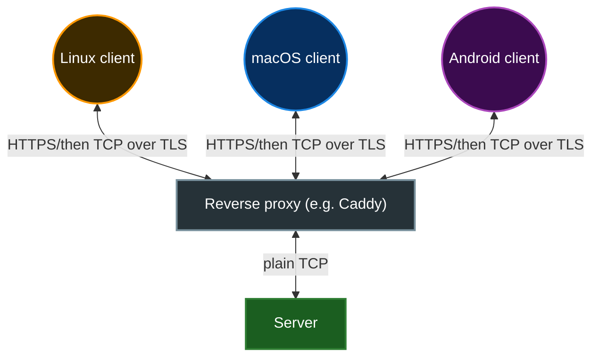

# MPClipboard

1. **M**ulti
2. **P**latform
3. **Clipboard**

This project implements a set of libraries and self-hosted apps (both desktop and mobile) to implement a shared clipboard buffer across multiple devices running on multiple platforms.

It requires a server for communication (can be local if you only need it for devices that run in the same local network).

Key components:

+ [Server](/server) - self-hosted server that sits behind a TLS-terminating reverse proxy (a single `no_std` binary, <1MB of RAM).
+ [Generic client](/generic-client) - a cross-platform library that is the heart of all desktop/mobile apps listed below. It talks HTTPS/TCP over TLS to the reverse proxy and implements a dead simple communication protocol on top of it. You can use it to build your own client for any platform. Written in Rust, has minimal [C bindings](/generic-client-ffi/bindings.h).
+ [Linux client](/linux) - integrates with Wayland clipboard, shows history in tray menu.
+ [macOS client](/macos) - integrates with macOS clipboard, shows history in tray menu, displays system notification when there's a new text received from the server.
+ [Android library](/android) - a Java wrapper around the generic client, as an `.aar`. It has no UI and no clipboard integration, the app that integrates it must provide both.
+ [Patched Simple Keyboard](https://github.com/iliabylich/simple-keyboard) - a patched version of the minimal custom IME app for Android called [Simple Keyboard](https://github.com/rkkr/simple-keyboard).

And potentially any other client can be implemented as well (iOS, Windows, etc).



### How it works

First the client sends an HTTP/1.1 upgrade request:

```
GET / HTTP/1.1
Host: <host>:<port>
Connection: Upgrade
Upgrade: mpclipboard-raw
Token: <token>
ID: <id>
Version: <protocol version>
```

Then the server replies with `101 Switching Protocols` (or `401 Unauthorized` if the token doesn't match). There's no other HTTP after that.

Since then both sides start exchanging fixed-size 256-byte frames: 1 byte of length (1..=255) followed by <length> bytes of UTF-8 text, zero-padded. Longer text snippets are truncated to 255 bytes on a UTF-8 char boundary, empty text can't be sent.

The server remembers the last message. A newly connected client immediately receives it. When a client sends a new message the server broadcasts it to all other clients. The last received message always wins, a message identical to the current one is ignored.

Every step of connecting (DNS, TCP connect, TLS handshake, upgrade) has a 3s timeout; TCP keepalive detects dead connections within a few seconds. Once the connection breaks, the client reports `Disconnected`, waits 3s and reconnects.

### Local development

Debug builds of clients trust a self-signed certificate from [`dev-certs`](/dev-certs), so the whole system can run locally:

```sh
mise run //server:dev                    # server on 127.0.0.1:3000 + Caddy on https://127.0.0.1:8443
mise run //generic-client:dev client-a   # a REPL client with id "client-a"
mise run //generic-client:dev client-b   # another one
```

Local mise configs point clients to `https://127.0.0.1:8443` and set the token to `sekret`.
