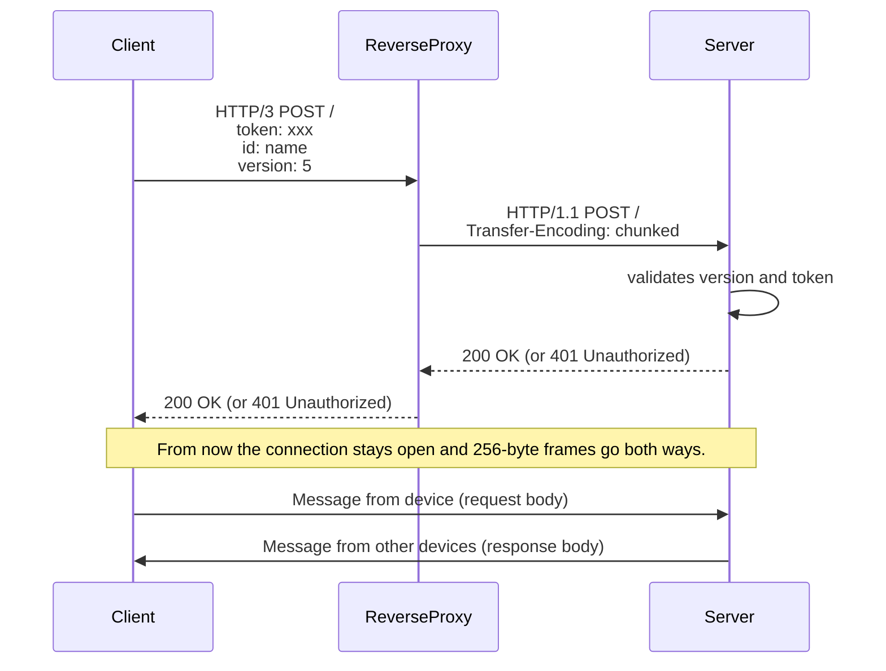

# `MPClipboard` server

This is the central part in communication process, a server that connects clients of all flavors.

It has only one endpoint: `/` that:

+ receives an incoming HTTP/1.1 `POST` request forwarded by a reverse proxy
+ performs authentication (or responds with `401 Unauthorized` if the token doesn't match)
+ responds with `200 OK` and keeps the request open as a bidirectional stream of messages
+ sends the most recent text to a newly connected client
+ starts receiving new texts from clients
+ broadcasts them to all connected clients

Authentication is based on a static token that is written in the `config.toml`.

The server itself doesn't handle TLS or HTTP/3, instead it expects a reverse proxy in front of it (e.g. Caddy or NGINX) to do TLS termination and "translation" to an old plain HTTP/1.1. The proxy must forward the request body as it arrives instead of buffering it, for Caddy that's `flush_interval -1`:

```
your.host {
	reverse_proxy 127.0.0.1:3000 {
		flush_interval -1
	}
}
```

### Configuration

The config must be located at `/etc/mpclipboard-server/config.toml` and it must look like this:

```toml
url = "http://127.0.0.1:3000" # must have a http://host:port format
token = "s3cr3t"
```

### Building

```
cargo build --release
```

Additionally, there's a [`debian/mpclipboard-server.service`](/debian/mpclipboard-server.service) systemd service if you need it.

### Running in Docker

We provide a Docker image on ghcr.io (GitHub container registry).

First, you need a `config.toml` file. Inside a container the server must listen on all interfaces, otherwise port mapping can't reach it:

```toml
url = "http://0.0.0.0:3000"
token = "s3cr3t"
```

Then:

1. optionally enable logging
2. specify port mapping
3. mount volume with a config

```sh
docker run \
    -e RUST_LOG=trace \
    -p 3000:3000 \
    -v ./config.toml:/etc/mpclipboard-server/config.toml:ro \
    ghcr.io/iliabylich/mpclipboard:latest
```

### Communication protocol

+ clients and reverse proxy communicate in HTTP/3
+ reverse proxy does TLS termination and translation to HTTP/1.1 and forwards it to the app
+ the whole session is a single never ending `POST /` request
+ this request has `Transform-encoding: chunked` set one way and it's unframed (i.e. raw stream) out

Every message is a fixed 256-byte frame: 1 byte of text length followed by up to 255 bytes of UTF-8 text (zero-padded). A frame with length 0 is a heartbeat.


